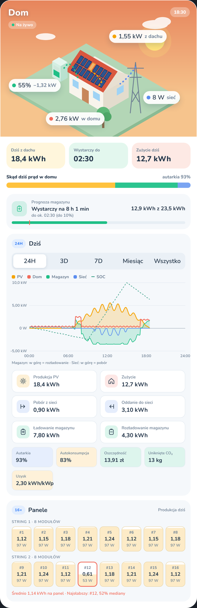
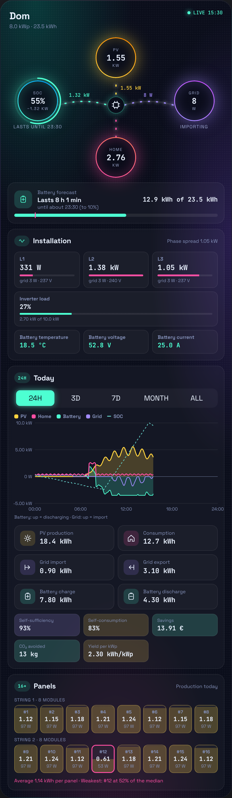
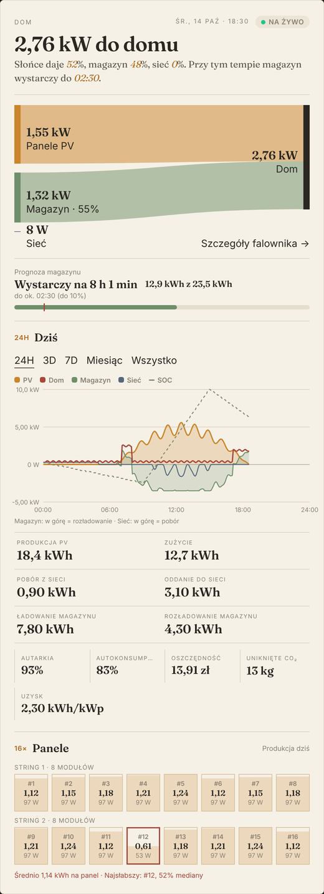
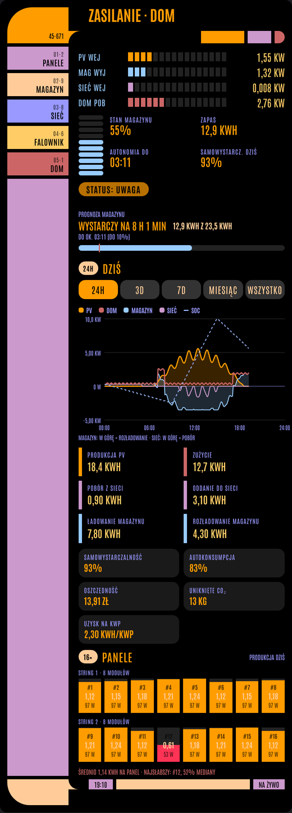
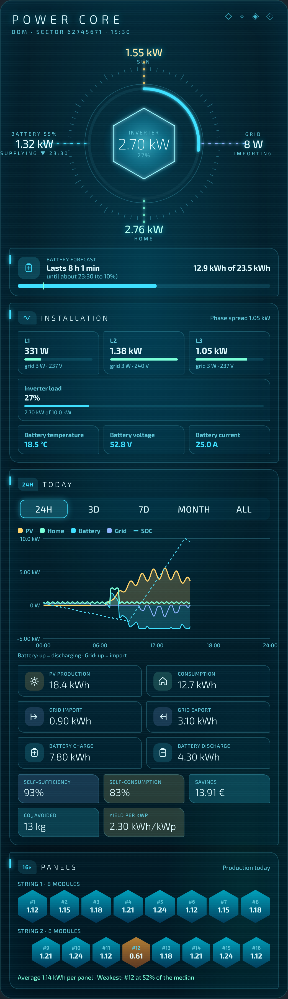

# Solar Flow Card

[](https://hacs.xyz/docs/faq/custom_repositories/)
[](https://github.com/gratak/solar-flow-card/releases)
[](LICENSE)

[](https://my.home-assistant.io/redirect/hacs_repository/?owner=gratak&repository=solar-flow-card&category=plugin)

> **Beta.** Things may still change between versions; please report problems in the issues.

A Home Assistant dashboard card for solar installations with a battery: live power flow, charts, a battery forecast, inverter details and per-panel production, in five themes.

DeyeCloud sensors are found automatically; any other inverter works by pointing the card at its entities.

| Diorama | Aurora | Paper | LCARS | Atlantis |
|---|---|---|---|---|
|  |  |  |  |  |

## Features

- **Live power flow** between solar, battery, grid and home, animated in the direction energy moves.
- **Periods** 24H, 3D, 7D, month and all time for production, consumption, grid import/export and battery charge/discharge.
- **Charts** following the selected period: power over the day (24H, 3D) and daily or monthly energy bars (7D, month, all). Hover or tap for values.
- **Period summary**: self-sufficiency, self-consumption, savings, avoided CO₂ and yield per kWp (energy produced per kW of installed panels; compare days and installations). Each item can be switched off.
- **Installations without PV** (battery with an EMS): `show_solar: false`.
- **Battery forecast**: time until full while charging, time until the reserve while discharging.
- **Inverter details** (tap the inverter or the house): PV strings, temperatures, battery and grid readings.
- **Panels**: one tile per optimizer with today's production; the weakest panel is highlighted when it falls below 85% of the median.
- English and Polish, with a visual editor; [more languages welcome](CONTRIBUTING.md#add-or-improve-a-translation).

History comes from Home Assistant itself (recorder history and long-term statistics), so the card adds no requests to your inverter's cloud.

## Themes

| Theme | Look |
|---|---|
| `diorama` | An isometric house with your panels on the roof; the sky follows the time of day, windows light up at night. |
| `aurora` | Neon rings and glowing flows on a night sky. |
| `paper` | An editorial page: a sentence that explains the moment and a Sankey diagram of where the power goes. |
| `lcars` | A starship operations panel with segment bars, a battery cell gauge and a status line. |
| `atlantis` | A holographic power core with the battery in a crystal and hexagonal panels. |

## Installation

### HACS

Click the button to open the card in HACS on your Home Assistant (HACS must be installed):

[](https://my.home-assistant.io/redirect/hacs_repository/?owner=gratak&repository=solar-flow-card&category=plugin)

Or add it by hand:

1. HACS → ⋮ → **Custom repositories** → add `https://github.com/gratak/solar-flow-card`, type **Dashboard**.
2. Search for **Solar Flow Card**, **Download**.
3. Reload the browser. HACS adds the dashboard resource for you.

While the card is in beta its releases are marked as pre-releases: in HACS open the card, ⋮ → **Redownload** and turn on **Show beta versions** to pick one.

### Manual

Copy `solar-flow-card.js` to `config/www/` and add a dashboard resource `/local/solar-flow-card.js` of type **JavaScript module**.

## Configuration

The visual editor covers the theme, title, language, your installation, sections and the summary items. `period`, `panel_strings` and the sensor options are YAML only.

```yaml
type: custom:solar-flow-card
theme: diorama
battery_capacity: 23.5
battery_min_soc: 20
pv_capacity: 8
pv_panels: 16
price_import: 1.10
price_export: 0.30
co2_factor: 0.7
```

### General

| Option | Default | Description |
|---|---|---|
| `theme` | `diorama` | `diorama`, `aurora`, `paper`, `lcars` or `atlantis`. |
| `title` | station name | Card title. |
| `language` | Home Assistant language | `en` or `pl`; also in the visual editor. |
| `period` | `today` | Tab shown when the dashboard opens: `today`, `3d`, `7d`, `month` or `all`. |
| `station_id` | first station | DeyeCloud station, when the account has several. |
| `animation` | `true` | Animated flows. |
| `load_fonts` | `true` | Load the theme's font from Google Fonts; `false` uses system fonts. |

### Your installation

| Option | Default | Description |
|---|---|---|
| `show_solar` | `true` | `false` for installations without PV (a battery with an EMS): every theme drops the sun, roof modules, PV production and the PV-based summary items. |
| `battery_capacity` | – | Usable battery capacity in kWh. Enables the battery forecast and the stored energy. |
| `battery_min_soc` | `10` | Battery reserve in %. "Lasts until" counts down to this level. |
| `pv_capacity` | – | PV size in kWp. Enables the yield per kWp. |
| `pv_panels` | `8` | Modules drawn on the Diorama roof when no optimizers are found. |
| `panel_strings` | `1` (`2` above 8 panels) | Number of strings the panels are split into, in order. |
| `price_import` | – | Price per kWh bought from the grid. Enables the savings. |
| `price_export` | `0` | Price per kWh sold to the grid. |
| `currency` | by language (`zł`, `€`) | Currency shown with the savings. |
| `co2_factor` | `0.5` | kg of CO₂ per kWh from the grid (Poland: about `0.7`). |

### Sections

| Option | Default | Description |
|---|---|---|
| `show_energy` | `true` | Energy section: period tabs, chart, tiles and summary. |
| `show_chart` | `true` | Chart in the energy section. |
| `show_forecast` | `true` | Battery forecast (needs `battery_capacity`). |
| `show_panels` | `true` | Optimizer / panel tiles (shown only when panel data exists). |

### Period summary

| Option | Default | Description |
|---|---|---|
| `show_autarky` | `true` | Self-sufficiency: share of consumption not taken from the grid. |
| `show_self_use` | `true` | Self-consumption: share of PV production used on site. |
| `show_savings` | `true` | Savings (needs `price_import`). |
| `show_co2` | `true` | Avoided CO₂. |
| `show_yield` | `true` | Yield per kWp: energy produced per kW of installed panels (needs `pv_capacity`). |

### Sensors

| Option | Default | Description |
|---|---|---|
| `entities` | DeyeCloud, automatic | Sensors for other inverters, see below. |
| `panels` | DeyeCloud optimizers | Per-panel energy sensors, see below. |
| `invert_battery` | `false` | Your signed battery power is positive while charging. |
| `invert_grid` | `false` | Your signed grid power is positive while exporting. |

### Other inverters

Set the entities the card should use. Every key is optional; use either separate import/export (charge/discharge) sensors or one signed sensor.

```yaml
type: custom:solar-flow-card
entities:
  solar_power: sensor.pv_power                 # W
  load_power: sensor.house_power               # W
  battery_power: sensor.battery_power          # W, + discharging / − charging
  battery_soc: sensor.battery_soc              # %
  grid_power: sensor.grid_power                # W, + import / − export
  # or: grid_import_power / grid_export_power, battery_charge_power / battery_discharge_power
  solar_energy: sensor.pv_energy_today         # kWh today, state_class total_increasing
  load_energy: sensor.house_energy_today
  grid_import_energy: sensor.grid_import_today
  grid_export_energy: sensor.grid_export_today
  battery_charge_energy: sensor.battery_charge_today
  battery_discharge_energy: sensor.battery_discharge_today
panels:                                        # optional, energy today per panel
  - sensor.panel_1_energy_today
  - entity: sensor.panel_2_energy_today
    power: sensor.panel_2_power
    name: South 2
```

The 3D, 7D, month and all-time totals and bars come from the long-term statistics of the daily energy sensors, so those need `state_class: total_increasing`. Statistics are compiled hourly; today's part always uses the live sensor.

## Translations

The card speaks English and Polish. Every language is one JSON file in [`translations/`](translations/); adding yours takes a copy of `en.json` and no programming. See [CONTRIBUTING.md](CONTRIBUTING.md#add-or-improve-a-translation).

## Development

The card is built from `src/*.js` and `translations/*.json` into `solar-flow-card.js` (after a merge into `main` a GitHub Action does this automatically):

```sh
node scripts/build.mjs
```

`demo/index.html` runs the card against a stand-in Home Assistant (`demo/mock-hass.js`) with DeyeCloud-style data; serve the repository root and open it to try themes, scenarios and languages. `node scripts/screenshots.mjs` (needs Playwright) renders the screenshots in `docs/`.

## License

MIT. The data layer started from the Energy Flow card of [hass-deyecloud](https://github.com/heavenknows1978/hass-deyecloud) by Trần Công Tuấn Anh, also MIT.
